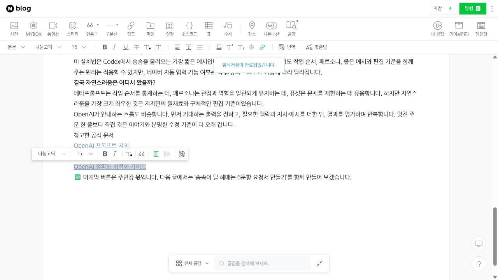

# AI 냠냠 · 네이버 블로그 조수

**AI를 한두 번 써봤지만 실제 업무 흐름으로 연결하지 못한 비개발 실무자를 위한 파일 중심 콘텐츠 스킬입니다.**

솜솜은 조사·검증·편집을 맡는 내부 조수입니다. 공개 글에서는 주인장이 직접 경험하고 판단한 목소리로 씁니다.

> 블로그 약속: **AI는 쉽게 정리하고, 업무 적용과 추천은 직접 확인한 뒤에만 이야기합니다.**

[](media/somsom-naver-auto-input.gif)

## 지금 무엇이 되나요?

| 상태 | 기능 |
|---|---|
| ✅ 이 저장소에 포함 | 주제 후보, 승인형 원고 작성, 부분 수정, 로컬 검증, 허브·성과 기록 양식 |
| 🧩 환경 도구에 의존 | 로그인된 네이버 새 편집기에 제목·본문·이미지 입력 |
| 🧪 별도 엔진·실험 | 파일 경로형 Playwright MCP, locator registry, UI fingerprint, 자동 허브 갱신 |

현재 저장소만 설치한다고 네이버가 자동으로 움직이지는 않습니다. 브라우저 입력은 연결된 도구가 필요하며, 안정화 전에는 사람이 편집기에서 최종 확인합니다.

## 1분 설치

### Codex에게 설치 맡기기

```text
$skill-installer로
https://github.com/swaan-kim/naver-blog-ai-assistant 저장소의
skills/naver-blog-assistant 스킬을 설치해줘.
```

### ZIP으로 직접 설치하기

1. [Download ZIP](https://github.com/swaan-kim/naver-blog-ai-assistant/archive/refs/heads/main.zip)을 내려받아 압축을 풉니다.
2. `skills/naver-blog-assistant` 폴더를 복사합니다.
3. 아래 위치에 같은 이름으로 붙여 넣습니다.

```text
Windows: C:\Users\사용자이름\.agents\skills\naver-blog-assistant
macOS/Linux: ~/.agents/skills/naver-blog-assistant
```

Codex가 스킬을 바로 찾지 못하면 앱이나 CLI를 다시 시작합니다. Python 3.10 이상을 사용하며 검증 스크립트에는 외부 패키지가 필요하지 않습니다.

## 가장 짧은 사용법

```text
$naver-blog-assistant로 이번 주 AI 냠냠 시작.
최근 14일 공식 발표와 오래가는 실용 질문을 확인해 후보 5개만 보여줘.
아직 원고는 쓰지 마.
```

주제를 고른 뒤:

```text
2번으로 진행하자.
검색형·상황형·보상형 제목과 목차만 제안해줘.
내가 승인하기 전에는 draft.md를 만들지 마.
```

최종 원고를 확인한 뒤 현재 글에 정확히 `발행`이라고 요청해야 발행 단계가 열립니다.

## 독자가 보게 될 구조

핵심 독자는 기획·마케팅·운영·CX의 비개발 실무자이고, 보조 독자는 디자이너와 주니어 PM입니다. 형식이 아니라 독자의 문제로 글을 묶습니다.

1. 반복 업무를 줄이는 AI
2. 개발자를 기다리지 않고 직접 해보기
3. 회사에서 안전하게 AI 쓰기
4. AI 결과를 덜 어색하게 다듬기

각 묶음은 관심을 끄는 `entry` 글과 직접 사용·검증하는 `proof` 글 한 편으로 구성합니다. 기존 게시글 9편은 `legacy_excluded`로 두고 새 허브나 관계 계산에 넣지 않습니다.

새 허브 제목은 **AI를 일에 써보고 싶은 사람의 시작 지도**입니다. 공개 블로그 소개 문구 권장안은 다음과 같습니다.

> AI는 쉽게, 업무 적용은 직접 확인합니다. 기획·마케팅·운영 실무자를 위한 AI·AX 실험 기록.

## 한 편의 흐름

```text
실제 문제 장면
→ 먼저 알려주는 한 줄 답
→ 직접 시도하거나 확인한 과정
→ 예상과 달랐던 점
→ 사람이 판단해야 했던 지점
→ 오늘 해볼 한 가지
→ 의미상 다음 질문
```

첫 화면에는 `이런 분께·읽는 시간·한 줄 답·이 글에서 볼 것`을 둡니다. 각 글에는 직접 캡처, 전후 비교, 실패와 수정, 작은 실험, 실제 업무 흐름, 원본 도식 중 하나가 반드시 있어야 합니다.

## 파일 중심 흐름

```text
후보 5개 → 주제·목차 승인 → brief.md
→ draft.md 한 번 생성 → 필요한 문단만 수정
→ 로컬 검사 → 파일 경로로 편집기 준비
→ 사람 검수 → 정확히 “발행” → 허브·다음 글·측정 갱신
```

글마다 `brief.md`, `draft.md`만 만들고 공유 `content-index.json`을 단일 원본으로 사용합니다. 월별로는 `performance-log.csv`에 D+7·D+28 지표만 추가합니다. 원문 자료 전문이나 네이버 DOM은 저장하지 않습니다.

템플릿:

- [brief](skills/naver-blog-assistant/assets/brief-template.md)
- [draft](skills/naver-blog-assistant/assets/draft-template.md)
- [content-index v2](skills/naver-blog-assistant/assets/content-index-template.json)
- [성과 기록](skills/naver-blog-assistant/assets/performance-log-template.csv)
- [나만의 조수 설정](skills/naver-blog-assistant/assets/persona-template.md)

## 토큰을 아끼는 지점

| 기존 대화형 흐름 | 파일 중심 흐름 |
|---|---|
| 작은 수정에도 원고 전문 재생성 | 지정된 문단만 패치 |
| 기획·작성·브라우저 규칙을 함께 읽음 | 필요한 참고 문서만 읽음 |
| 원고를 브라우저 호출마다 전달 | 정상 경로는 `draft.md` 경로만 전달 |
| AI가 분량·중복·링크를 다시 읽음 | 로컬 스크립트가 결정형 검사 |
| 성공 때도 화면·DOM을 반복 확인 | 성공은 메타데이터만, 실패는 로컬 진단 |

절감률은 아직 전체 작업의 실측값으로 공개하지 않습니다. 8편 파일럿에서 같은 길이 원고의 모델 관여 단계, 원고 전문 전달 횟수, DOM·스크린샷 확인 횟수, 재시도, 소요 시간을 비교한 뒤 범위를 밝힙니다.

## 로컬 검증

초안 확인:

```powershell
python skills/naver-blog-assistant/scripts/validate_draft.py content/posts/YYYY-MM-DD-slug/draft.md --json
```

승인·출처·고유 증거·최신성·이미지·관계까지 확인:

```powershell
python skills/naver-blog-assistant/scripts/validate_package.py content/posts/YYYY-MM-DD-slug `
  --index content/content-index.json --stage prepare --json
```

발행 직전에는 `--stage publish`로 다시 검사합니다. 차단 오류는 비밀정보, 미해결 표시, 승인·출처·증거·권리·최신성·관계 누락입니다. 글자 수, 제목 길이, 소제목 수 같은 편집 기준은 경고로 보여주어 자연스러운 글을 억지로 늘리지 않습니다.

## Playwright 연결 계약

별도 `naver-blog-mcp` 엔진은 다음 두 호출을 목표로 합니다.

```text
naver_blog_prepare_post(draft_path)
naver_blog_publish_current(expected_title, update_series_links=true, confirmation="발행")
```

- 저장된 role·label·selector와 UI fingerprint를 사용합니다.
- 고정 좌표는 사용하지 않습니다.
- locator가 바뀌면 `SELECTOR_MISS`로 중단합니다.
- 성공 시 제목·글자 수·문단 수·상태·URL만 반환합니다.
- `confirmation`이 정확히 `발행`일 때만 실행합니다.
- 불확실한 발행은 `outcome_uncertain`, 링크만 실패하면 오류 코드 `PARTIAL_LINK_UPDATE`와 상태 `partial_link_update`로 남기며 재발행하지 않습니다.

이 계약은 실행 엔진의 구현 완료를 뜻하지 않습니다. README의 상태표가 `🧪`에서 바뀌려면 서로 다른 글 준비 5회와 명시적 승인 발행 2회를 통과해야 합니다.

## 성과는 이렇게 확인합니다

- D+1: 공개 설정, 제목, 허브·다음 글 링크
- D+7: 조회수, 검색 유입 비중·검색어, 댓글·공감, 작업시간
- D+28: 같은 지표의 누적값과 작성·검수 부담
- 월말: 블로그 전체 재방문율, 평균 방문 횟수, 이웃 순증
- D+90: 가격·정책·기능·보안 글의 최신성

첫 달에는 조회수 목표를 만들지 않습니다. 같은 형식끼리 비교해 `유지 1개·변경 1개·시험 1개`만 정하고, 네이버가 제공하지 않는 내부 링크 CTR이나 완독률은 만들지 않습니다.

## 안전 원칙

- 로그인과 인증은 사용자가 직접 합니다.
- 비밀번호, 인증번호, 쿠키, 세션, API 키를 원고나 Git에 넣지 않습니다.
- 기존 글과 다른 임시저장 글을 수정하지 않습니다.
- 셀렉터가 맞지 않으면 좌표를 추측하지 않습니다.
- `[[확인 필요]]`가 하나라도 있으면 준비와 발행을 중단합니다.
- 추천은 직접 사용한 경우에만 하며 사용 정도를 함께 밝힙니다.
- AI 생성·편집 이미지는 메타데이터와 네이버 `AI 활용` 설정에 표시합니다.

## 파일럿

[파일럿 시작 안내](pilot/START-HERE.md)에는 허브와 비교용 제안 원고가 있습니다. 4주 동안 `entry + proof` 네 쌍을 운영하고, 허위 경험·출처 오류·이미지 권리 문제·오발행 0건과 D+7·D+28 기록을 확인한 뒤 공개 스킬에 결과를 반영합니다.

첫 3편의 독자 설정, 발행 순서, 근거, 모의 독자 점수와 수정 내역은 [콘텐츠 방향·검수 기록](pilot/CONTENT-DIRECTION-2026-11-19.md)에서 확인할 수 있습니다. 이 점수는 실제 방문자 조사나 조회수 예측이 아니라 편집 단계의 역할극 평가입니다.

## 저장소 구조

```text
skills/naver-blog-assistant/
├─ SKILL.md
├─ references/
│  ├─ topic-research.md
│  ├─ editorial-workflow.md
│  ├─ writing-guide.md
│  ├─ browser-workflow.md
│  ├─ distribution-linking.md
│  └─ measurement-guide.md
├─ assets/
├─ scripts/
└─ tests/
```

## 라이선스

MIT License로 공개합니다. 개인·팀 프로젝트에서 수정하고 재배포할 수 있습니다.
